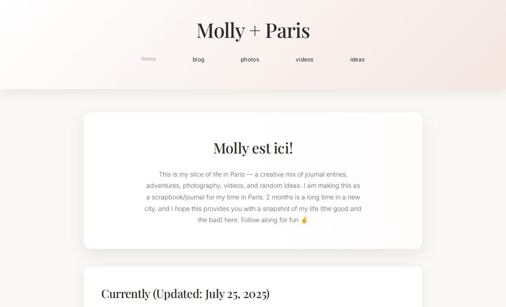

# Molly + Paris: Personal Journal Website

**A creative personal site I designed and built from scratch to document two months living and working in Paris (Summer 2025).**

**[Live site →](https://paris-website-one.vercel.app)** · Deployed on Vercel

## Features
- **Blog:** dated journal entries about life and work in Paris
- **Photo gallery** and **video snippets**
- **Ideas board:** a free-form "idea dump" and mood board
- **Supabase integration (in progress):** functions to store blog posts, photo layouts and mood-board items in Postgres, with image uploads to Supabase Storage

## Tech stack
HTML5 · CSS3 · JavaScript · Supabase (Postgres + Storage) · Vercel
